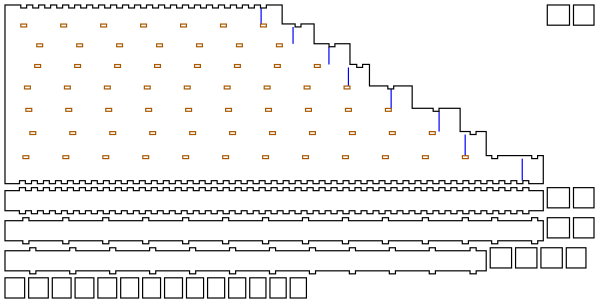

# Panpipes

<!-- readme-only -->
**[Read the writeup](https://gernreich.github.io/panpipes/)** ·
**[Turn it in 3D](https://gernreich.github.io/panpipes/#turn-it-in-3d)**

<!-- page-only **[Read the README](https://github.com/Gernreich/panpipes)** -->

A low raft of panpipes in 3mm plywood: eight closed pipes from E3 to E4, the E natural
minor scale, side by side between two plates. You blow across the open tops, one pipe
at a time. Each pipe is stopped by a plug pressed up from its open bottom, and moving
the plug tunes it.

The same pipes also come as **separate tubes glued side to side**, in four shapes:
octagons in a row, octagons in two rows as a siku's are, hexagons in a zigzag, and
hexagons in a row.
[The tube sets](#the-tube-sets) describes them.

Output is millimetre-true — `1 user unit = 1mm` with a physical `width`/`height` — so
it prints and cuts at real size.

**It has not been cut or played yet.** The pipe lengths come from the quarter-wave
formula with a textbook end correction, and the player's lip changes that correction.
The plugs are there to absorb it: [Before you cut](#before-you-cut) says by how much.

<table>
<tr>
<td align="center"><a href="cut-files/panpipes-E3-chamfer-sheet1-cut-files.svg"></a></td>
</tr>
<tr>
<td align="center"><sub>sheet 1 of 3: the front plate, three walls and every plug</sub></td>
</tr>
</table>

Built for **[LaserMadeMusic](https://www.youtube.com/@LaserMadeMusic)**.

**[The rest of the build files](https://gernreich.github.io/)** — every instrument,
generator and tool, indexed.

**[Download everything as a ZIP](https://github.com/Gernreich/panpipes/archive/refs/heads/main.zip)**

## The panpipes

| | |
|---|---|
| Notes | E3 F♯3 G3 A3 B3 C4 D4 E4, the E natural minor scale, low to high |
| Bore | rectangular, 20mm front to back in every pipe, 22mm across the lowest narrowing to 16mm across the highest |
| Raft | 179mm across, 26mm deep, 538.8mm down the longest pipe |
| Parts | 35: two plates, nine walls and 24 plug layers, on three sheets of 3mm ply; the strip edge adds a strip of 1.5mm stock |
| Joints | press-fit throughout, sealed with shellac; only the strip edge is glued |

**Why it stops at E3.** A closed pipe sounds a quarter wavelength, so E3 needs about
518mm of air, and the pipe is cut 21mm longer again for its plug and the room to move
it. D3 would need a pipe about 603mm long, and the parts must fit a 600 × 305mm bed
with a margin round them.

**Why the pipes narrow.** Low pipes want a wide bore to sound full, and high ones a
narrow bore to speak easily: a pipe that is short for its width plays breathy. Every
pipe here is at least 12.7 times as long as the diameter of the circle of its area.
The depth, front to back, stays at 20mm so the plates stay flat.

| Pipe | Hz | Bore | Plug face, from the rim | Pipe as cut |
|---|---|---|---|---|
| E3 | 164.81 | 22.00 × 20mm | 517.8mm | 538.8mm |
| F♯3 | 185.00 | 21.14 × 20mm | 460.7mm | 481.7mm |
| G3 | 196.00 | 20.29 × 20mm | 434.6mm | 455.6mm |
| A3 | 220.00 | 19.43 × 20mm | 386.5mm | 407.5mm |
| B3 | 246.94 | 18.57 × 20mm | 343.8mm | 364.8mm |
| C4 | 261.63 | 17.71 × 20mm | 324.3mm | 345.3mm |
| D4 | 293.66 | 16.86 × 20mm | 288.3mm | 309.3mm |
| E4 | 329.63 | 16.00 × 20mm | 256.4mm | 277.4mm |

The tops are flush, so the rim is one straight line to blow along; the bottoms step
down with the pipes. Each pipe has, from the rim down:

- **The air column**, from the rim to the plug's face: a quarter wavelength less the
  open end's correction, 0.61 times the radius of the circle with the bore's area.
- **The plug**: three layers of ply, each 0.12mm bigger than the bore both ways, the
  square flute's press-fit for its plug discs. A blue line across the front plate
  marks where its face goes.
- **12mm of empty pipe** below the plug, so it can be pushed down to flatten the note
  as well as up to sharpen it.

**How it goes together.** The front and back plates are the faces; nine walls stand
between them, one between each pair of pipes and one at each end. An inner wall has
6mm tabs about 40mm apart, through slots in both plates. The two end walls have the
square flute's finger joint, a 6mm finger every 12mm, in notches in the plates' long
edges, flush with the outside. An inner wall is as long as the longer of its two pipes,
so it runs on past the shorter one's bottom, beside the plates' staircase edge; its
tabs there are fingers in notches in that edge.

## The blowing edge

A panpipe speaks when a thin jet of breath, aimed across the open top, strikes the
far rim, the top of the back plate, and flips in and out of the pipe. The far rim is
the pipe's only edge, and **its sharpness sets the tone**: a sharp edge gives a clear,
strong note that starts easily, and a blunt one a breathier note that needs the jet
aimed more exactly. Cane panpipes have walls 1 to 2mm thick. A laser cuts 3mm ply
square, which is at the blunt end of what plays.

**The near rim**, the front plate's top, is where the lower lip rests. It is not an
edge and does not need to be sharp. In every build, sand it round so it is comfortable.

The generator draws four blowing edges, chosen with `--edge=`; each has its own cut
files and its own view in 3D. They differ only in the back plate and, for `strip`, a
fourth sheet.

### `chamfer`, the default: sand a bevel

The back plate is cut square, with a blue line engraved across its outside face 2mm
below the rim. **Sand a 45° bevel on the outside of the rim, down to the line**,
leaving 1mm of edge on the inside of the bore. The tops are flush, so a sanding block
held at 45° along the whole raft does every pipe at once, after assembly.

This is the one to start with: no extra parts, the laser marks where to stop, and a
1mm edge is in the cane pipes' range. Sand until the line just disappears, and no
further; the inside face must stay untouched, since that is the edge.

### `plain`: the edge as cut

The back plate as it comes off the laser, a 3mm square edge. It plays: wooden
panpipes drilled from a block have thick, rounded rims. Expect a breathier tone,
most of all in the short high pipes, and a narrower window of aim. Cut this one if
you want to hear the difference a bevel makes, and chamfer it afterwards: it is the
same plate without the line.

### `notch`: a quena's notch over every pipe

A U-shaped notch is cut into the back plate's rim over each pipe, half the pipe's
width across and up to 6.5mm deep, and a blue line is engraved round each one on the
back plate's outside face, 2mm out from the notch's edge. **File a 45° bevel on the
outside of each notch, down to its line**, leaving 1mm of edge on the inside of the
bore. That is a quena's notch: a U in the rim, bevelled from outside so the edge the
breath strikes is thin. A small round file, or sandpaper round a dowel, follows the U.

The notch gives the jet a definite place to aim, and the bevel the thin edge, so this
build has both. It is the most hand work of the four: eight small curved bevels in
place of one straight one. File until the line just disappears, and keep the file
off the inside face, which is the edge.

Notched panpipes are borrowed from the quena, not traditional: siku and nai pipes have
plain rims. The notch removes some of the back wall at the top of each pipe, which
shortens the pipe a little acoustically; the plugs take that up.

### `strip`: a thin edge glued on

The back plate stops 5mm short of the rim, and a strip of **1.5mm** stock, 5mm tall
and the raft's full width, is glued along its top edge, inner face flush with the
bore, so the rim is 1.5mm thick. The walls run up past the plate to the rim, and the
strip glues to their back edges as well. It is cut from its own sheet,
`panpipes-E3-strip-1.5mm-sheet1-cut-files.svg`, in 1.5mm ply or veneer.

This gives the thinnest edge without sanding, at the cost of a second material and
a glued joint, the one glued joint in any raft build. The strip has no joints of its own,
so its kerf hardly matters.

### Which to cut

| Edge | Edge left | Extra work | Extra parts |
|---|---|---|---|
| `chamfer` | 1mm | sand a 45° bevel to the line | none |
| `plain` | 3mm | none | none |
| `notch` | 1mm, at the bottom of a 6.5mm U | file a 45° bevel round each notch to its line | none |
| `strip` | 1.5mm | glue the strip on | one strip of 1.5mm stock |

## The tube sets

`tube_panpipes.py` builds the same eight pipes another way: each pipe its own tube of
3mm strips, finger-jointed edge to edge as the
[octagonal flute](https://github.com/Gernreich/octagonal-flute)'s tube is, and the
tubes **glued to each other** face to face. Separate tubes share no wall, so the glue
is what holds the set together; inside each tube the joints are press-fit and sealed
with shellac, as everywhere else. Each bore has the same area as the raft's pipe for
the same note, 440mm² at E3 down to 320mm² at E4, so the air columns, the plugs' lines
and the tuning are the raft's. [Before you cut](#before-you-cut) applies to the tubes
too: the stock, the kerf and the end correction are the same.

| Shape | Tube | Set | Parts | Glued |
|---|---|---|---|---|
| `octagon-row` | 8 strips, 23.05 to 19.65mm across the flats | 219.1 × 29.0mm | 88: 64 strips, 24 plug layers | side flat to side flat |
| `octagon-two-rows` | 8 strips, 23.05 to 19.65mm across the flats | 110.5 × 57.6mm | 88: 64 strips, 24 plug layers | side flat to side flat in each row, back flat to front flat between the rows |
| `hex-zigzag` | 6 strips, 22.54 to 19.22mm across the flats | 194.3 × 42.5mm | 72: 48 strips, 24 plug layers | diagonal flat to diagonal flat |
| `hex-row` | 6 strips, 22.54 to 19.22mm across the flats | 215.4 × 33.0mm | 72: 48 strips, 24 plug layers | side flat to side flat |

Each is four sheets of 3mm ply, the longest strip 538.9mm.

**`octagon-row`** is the closest to the raft: a flat to the front for the lip, a flat
to the back for the blowing edge, and a flat either side to glue to the neighbours.
It has the most strips, 64, and the narrowest faces, 10.6 to 12.0mm outside.

**`octagon-two-rows`** is the siku's layout. The Andean siku splits its scale between
two rows, one behind the other, so neighbouring notes alternate between them and the
instrument is half as wide. Here the front row is E3, G3, B3 and D4 and the back row
F♯3, A3, C4 and E4, each back pipe directly behind the note below it. Each row is
glued in a line, flat to flat, and the back row is glued to the back of the front
row, flat to flat again; the rims are level, as a siku's are. The set is 110.5mm
across, half the octagon row. Each back pipe is a little narrower than the one in
front of it, so the back row is slid to split the difference both ways, and the
faces glued between the rows share at least 5.6mm of flat face.

Gluing the rows together changes two details. A back-row pipe's front is glued
out of sight, so **its plug's blue line is on its back** instead. And a front-row
pipe's back face, its blowing edge, is glued to the back row, so it can take no
line and no notch: on a `chamfer` build, sand its bevel across the joint, leaving
1mm of the front pipe's wall flat at the rim and sloping down at 45° through both
walls. The slope reaches the back pipe's bore 5mm below its rim, lowering the near
rim of the back pipe, where the lip rests to play it. The `notch` edge is not drawn
for this shape.

**`hex-zigzag`** turns each hexagon so it has a flat to the front and one to the back,
and then its sides are corners, so it cannot sit flat beside its neighbour in a line.
Instead each pipe is glued to the next across a diagonal face, and the pipes alternate
between a front row and a back row 14mm behind it: E3, G3, B3 and D4 in front, F♯3,
A3, C4 and E4 behind, the scale split as a siku's is, but with the rows nested into
each other's gaps rather than one whole row behind the other. The rims are level.
`--raise=` stands the back row taller at the rim, `--raise=15` by 15mm, to bring each
back pipe's front face clear above the front row for the lip; that is an idea of
this design, not a tradition, and nobody has played either yet. Each pipe is glued to
two neighbours, on faces 14.6 to 16.5mm wide, 9.4mm of it clear of the joints.

**`hex-row`** turns the hexagons the other way, flats either side, and glues them in a
line. A corner faces the lip, so round it off with sandpaper, and the blowing edge is
a V of two back faces rather than one flat. That is the least conventional of the
three to play.

**The edges** are the raft's, on the back face of every tube:

- **`chamfer`**, the default: a line engraved 2mm below the rim on the back face, on
  both back faces for `hex-row`. Sand a 45° bevel down to it. The rims are at one
  height, but the back faces are not in line, since the tubes narrow, so bevel each
  tube on its own. On `octagon-two-rows` only the back row has the line; the front
  row's bevels go across the joint, as above.
- **`plain`**: the rim as cut.
- **`notch`**: the quena notch with its bevel line, narrower than the raft's to fit a
  single face: 4.9 to 5.7mm wide and 3.4 to 3.9mm deep on the octagons, 6.7 to
  7.8mm wide and 4.3 to 4.9mm deep on the hexagons. The back face keeps its whole width for 18mm below the rim, its
  neighbours' fingers moved clear, so the notch is never next to a joint. There is no
  notch on `hex-row`, which has a corner at the back, or on `octagon-two-rows`, whose
  front row's backs are glued.

<!-- readme-only -->
All four sets turn in 3D on the [published page](https://gernreich.github.io/panpipes/turn-tubes.html).

<!-- page-only <iframe src="turn-tubes.html" title="The four tube sets as solid parts you can drag to turn and pull apart: eight octagonal tubes in a row, eight octagonal tubes in two rows glued back to front, eight hexagonal tubes in a two-row zigzag, and eight hexagonal tubes in a row, with a button for each" style="width:100%;height:560px;border:0"></iframe> -->

### Building a tube set

1. Sort the strips by length: each length is one tube, eight strips for an octagon,
   six for a hexagon. A tube's strips are not all alike: the fingers along their edges
   come in three patterns, so each strip closes against only its own neighbours. Start
   from the front, the strip whose blue line is 21mm from one end, the bottom; work
   round it, each strip's fingers into the last one's gaps, and if a strip will not
   close, it belongs elsewhere in the ring. The back is the strip with the line 2mm
   below the rim on a `chamfer` build (two strips on `hex-row`), or with the U on a
   `notch` build. On `octagon-two-rows` the back row's plug lines are on their backs,
   so there the strip with both lines, or with the plug's line alone on a `plain`
   build, is the back. Rubber bands hold a tube while you work round it.
2. **Glue the tubes to each other before any shellac**, since glue will not take on
   shellac. Stand them rim down on something flat, so the rims come out level, and
   glue each to the next in order, low to high, the fronts all facing you. For
   `octagon-two-rows`, glue each row in a line first, then the back row to the back of
   the front row, each back pipe behind the note below it. On a `hex-zigzag` drawn
   with `--raise=`, the back row's rims stand past the front row's, so put a spacer
   that thick under the front row's rims.
3. Seal every seam with high-cut shellac, outside and inside each tube, from both ends.
4. Make the blowing edge, round the lip side of each rim, and shellac the rims.
5. Press the plugs in from below to their lines, and tune as for the raft, below.

## Turn it in 3D

<!-- readme-only -->
The panpipes turn in 3D on the [published page](https://gernreich.github.io/panpipes/#turn-it-in-3d),
which GitHub does not run: drag to turn them, pull them apart into their parts, and
switch between the four edges.

<!-- page-only <iframe src="turn.html" title="The panpipes as solid parts you can drag to turn and pull apart: a front plate, a back plate with its blowing edge along the top, the walls between the pipes and a plug in each pipe, with a button for each of the four blowing edges" style="width:100%;height:560px;border:0"></iframe> -->

## Before you cut

**The end correction is a textbook figure, and the lip changes it.** The pipes are
cut for 0.61 times the bore's equivalent radius, an unflanged open end's. Your lower
lip covers part of the opening and the raft's own width flanges it, and both make the
real correction different. The whole range from 0.3 to 0.61 moves the plugs 3.1 to
3.7mm, and every plug has 12mm of pipe below it to come down into, and as far as
it likes to go up. So the plugs can absorb it whichever way it falls.

**How far a plug tunes.** A millimetre of plug moves the note 3.3 cents in the E3
pipe and 6.6 cents in the E4 pipe. Pushed all the way down, into its 12mm, a plug
flattens its pipe by 39 cents (E3) to 77 cents (E4), and pushed up it sharpens it
as far as you like. To tune for another temperament or A, redraw with `--notes=` or
move the plugs.

**Cut it in 3mm Baltic birch plywood**, at a 0.13mm kerf. The tabs and fingers are
6mm wide with no play, so the fit comes from the kerf compensation alone. **If your
laser's kerf is not 0.13mm, redraw the sheets for its own** with `--kerf=`: a press-fit
that comes out loose wants a wider kerf, one too tight to close a narrower one.

**The longest parts are 538.9mm with the kerf**, the front plate, the back plate and
the end wall beside the lowest pipe. The largest sheet is 600 × 304mm, so the bed
must be the full 600 × 305mm. The generator checks against it.

Run the engrave first, then the cuts. **Blue** engraves the plugs' places on the front
plate and, on the `chamfer` and `notch` builds, the bevel's lines on the back plate. Then **orange**
cuts the slots, and **black** frees the parts. Both plates are drawn outside face up,
so the lines land on the outside. The tube sets have no slots: blue engraves the
plugs' places and the bevels' lines on the strips' outsides, and black frees the parts.

## Building it

1. For the `strip` edge only: glue the strip along the back plate's cut-down top
   edge, inner faces flush, and let it dry. Every other edge is made after assembly.
2. Press the nine walls into the back plate, tabs through the slots, its outside
   face down. The two end walls go in the notches along its long edges, the longer
   one beside the E3 pipe. Each inner wall fits only its own place, since every wall
   is a different length.
3. Lay the front plate on, outside face up, so its blue lines show, and press it down
   onto the walls' tabs. Rubber bands round the raft hold it while you work along.
4. Seal every seam with high-cut shellac, outside and inside as far as a brush on a
   stick reaches down each pipe from both ends. A closed pipe that leaks will not
   speak at its bottom note.
5. Make the blowing edge: for `chamfer`, sand the bevel down to the line; for
   `notch`, file each notch's bevel down to its line. Round the front rim where
   the lip rests in every build, and shellac both rims, which are end grain.
6. Once the shellac is dry, press each pipe's three plug layers up into it from the
   bottom, one at a time, with a dowel, until the top one's face is at the pipe's blue
   line. Sealing first keeps shellac off the plugs, which have to stay free to move.

## Tuning

Blow each pipe and read its pitch with a tuner. **Flat: push the plug up. Sharp: push
it down.** Move it a millimetre at a time; at 3.3 to 6.6 cents a millimetre, a
millimetre is a lot.

A plug that has gone too far up comes back down by pushing from the top with a long
dowel. If a plug works loose, shellac on its edges, left to dry before it goes back
in, tightens it.

## Regenerating it

```sh
python3 panpipes.py --no-write                  # the checks, writing nothing
python3 panpipes.py --out=cut-files             # the chamfer build's sheets
python3 panpipes.py --edge=notch --out=cut-files     # another edge: chamfer, plain, notch, strip
python3 panpipes.py --notes=G3,A3,B3,C4,D4,E4,F#4,G4 --no-write   # other pipes, low to high
python3 panpipes.py --end=0.4 --no-write        # a different open-end correction
python3 panpipes.py --kerf=0.18 --out=mine      # for a laser with a 0.18mm kerf
python3 panpipes.py --page-to=turn.html         # the 3D view, all four edges
python3 tube_panpipes.py --shape=hex-zigzag --no-write     # a tube set's checks: octagon-row, octagon-two-rows, hex-zigzag, hex-row
python3 tube_panpipes.py --shape=octagon-row --edge=notch --out=cut-files   # its sheets
python3 tube_panpipes.py --shape=hex-zigzag --raise=15 --no-write   # the back row 15mm taller
python3 tube_panpipes.py --page-to=turn-tubes.html   # the tube sets' 3D view
```

`panpipes.py` draws nothing until every check passes:

- every blue line on the front is its plug's face;
- the walls stand a bore apart;
- every plug is a press-fit in its bore;
- every plug can come down as well as go up;
- every pipe is walled to its bottom;
- the rim is clear of every joint;
- every slot keeps ply between it and the plate's edge;
- no tab straddles a pipe's bottom, which it reports only when one does;
- on the `notch` build, every notch stays within its pipe and clear of the joints;
- on the `notch` build, every notch has its bevel line, clear of the joints;
- on the `chamfer` build, the bevel leaves an edge inside the bore;
- no pipe is fat for its length;
- the longest part fits the bed;
- every sheet fits the bed;
- every part is on a sheet.

`tube_panpipes.py` checks that every blue line is its plug's face, on a face no
neighbour is glued over, that
every bore is the area the pipe is tuned for, that every plug is a press-fit and can
come down as well as go up, that every glued face lies flat on its neighbour's and
no two tubes overlap, that a face keeps ply between its two joints, that every notch
and its bevel line fit the back face or every free back face has its bevel line, and the
same pipe, part and sheet checks.

`panpipes.py` imports the square flute's kerf, finger joint and packer from `square_flute.py`,
and the mitred offset from the four-hole ocarinas' `four_hole_ocarinas.py`;
`tube_panpipes.py` also takes the tube's joint from their `polyhedron.py`. So
[square-flute](https://github.com/Gernreich/square-flute),
[four-hole-ocarinas](https://github.com/Gernreich/four-hole-ocarinas),
[swept-curve](https://github.com/Gernreich/swept-curve) and
[lasermade-tools](https://github.com/Gernreich/lasermade-tools) must be checked out
beside this repository.

## Files

Every raft build is three sheets of 3mm ply, and the strip edge adds a fourth, of 1.5mm stock; every tube set is four sheets.

| | |
|---|---|
| `cut-files/panpipes-E3-chamfer-sheet1-cut-files.svg` | chamfer, sheet 1: the front plate with the plugs' lines, three walls and all 24 plugs |
| `cut-files/panpipes-E3-chamfer-sheet2-cut-files.svg` | chamfer, sheet 2: the back plate, with the bevel's line, and three walls |
| `cut-files/panpipes-E3-chamfer-sheet3-cut-files.svg` | chamfer, sheet 3: the last three walls |
| `cut-files/panpipes-E3-plain-sheet1-cut-files.svg` | plain, sheet 1: the front plate with the plugs' lines, three walls and all 24 plugs |
| `cut-files/panpipes-E3-plain-sheet2-cut-files.svg` | plain, sheet 2: the back plate and three walls |
| `cut-files/panpipes-E3-plain-sheet3-cut-files.svg` | plain, sheet 3: the last three walls |
| `cut-files/panpipes-E3-notch-sheet1-cut-files.svg` | notch, sheet 1: the front plate with the plugs' lines, three walls and all 24 plugs |
| `cut-files/panpipes-E3-notch-sheet2-cut-files.svg` | notch, sheet 2: the back plate, notched over every pipe with a bevel line round each notch, and three walls |
| `cut-files/panpipes-E3-notch-sheet3-cut-files.svg` | notch, sheet 3: the last three walls |
| `cut-files/panpipes-E3-strip-sheet1-cut-files.svg` | strip, sheet 1: the front plate with the plugs' lines, three walls and all 24 plugs |
| `cut-files/panpipes-E3-strip-sheet2-cut-files.svg` | strip, sheet 2: the back plate, cut down for the strip, and three walls |
| `cut-files/panpipes-E3-strip-sheet3-cut-files.svg` | strip, sheet 3: the last three walls |
| `cut-files/panpipes-E3-strip-1.5mm-sheet1-cut-files.svg` | strip, the edge strip, on its own sheet of 1.5mm stock |
| `cut-files/panpipes-E3-hex-row-chamfer-sheet1-cut-files.svg` | hex-row, chamfer edge, sheet 1 of 4 |
| `cut-files/panpipes-E3-hex-row-chamfer-sheet2-cut-files.svg` | hex-row, chamfer edge, sheet 2 of 4 |
| `cut-files/panpipes-E3-hex-row-chamfer-sheet3-cut-files.svg` | hex-row, chamfer edge, sheet 3 of 4 |
| `cut-files/panpipes-E3-hex-row-chamfer-sheet4-cut-files.svg` | hex-row, chamfer edge, sheet 4 of 4 |
| `cut-files/panpipes-E3-hex-row-plain-sheet1-cut-files.svg` | hex-row, plain edge, sheet 1 of 4 |
| `cut-files/panpipes-E3-hex-row-plain-sheet2-cut-files.svg` | hex-row, plain edge, sheet 2 of 4 |
| `cut-files/panpipes-E3-hex-row-plain-sheet3-cut-files.svg` | hex-row, plain edge, sheet 3 of 4 |
| `cut-files/panpipes-E3-hex-row-plain-sheet4-cut-files.svg` | hex-row, plain edge, sheet 4 of 4 |
| `cut-files/panpipes-E3-hex-zigzag-chamfer-sheet1-cut-files.svg` | hex-zigzag, chamfer edge, sheet 1 of 4 |
| `cut-files/panpipes-E3-hex-zigzag-chamfer-sheet2-cut-files.svg` | hex-zigzag, chamfer edge, sheet 2 of 4 |
| `cut-files/panpipes-E3-hex-zigzag-chamfer-sheet3-cut-files.svg` | hex-zigzag, chamfer edge, sheet 3 of 4 |
| `cut-files/panpipes-E3-hex-zigzag-chamfer-sheet4-cut-files.svg` | hex-zigzag, chamfer edge, sheet 4 of 4 |
| `cut-files/panpipes-E3-hex-zigzag-notch-sheet1-cut-files.svg` | hex-zigzag, notch edge, sheet 1 of 4 |
| `cut-files/panpipes-E3-hex-zigzag-notch-sheet2-cut-files.svg` | hex-zigzag, notch edge, sheet 2 of 4 |
| `cut-files/panpipes-E3-hex-zigzag-notch-sheet3-cut-files.svg` | hex-zigzag, notch edge, sheet 3 of 4 |
| `cut-files/panpipes-E3-hex-zigzag-notch-sheet4-cut-files.svg` | hex-zigzag, notch edge, sheet 4 of 4 |
| `cut-files/panpipes-E3-hex-zigzag-plain-sheet1-cut-files.svg` | hex-zigzag, plain edge, sheet 1 of 4 |
| `cut-files/panpipes-E3-hex-zigzag-plain-sheet2-cut-files.svg` | hex-zigzag, plain edge, sheet 2 of 4 |
| `cut-files/panpipes-E3-hex-zigzag-plain-sheet3-cut-files.svg` | hex-zigzag, plain edge, sheet 3 of 4 |
| `cut-files/panpipes-E3-hex-zigzag-plain-sheet4-cut-files.svg` | hex-zigzag, plain edge, sheet 4 of 4 |
| `cut-files/panpipes-E3-octagon-row-chamfer-sheet1-cut-files.svg` | octagon-row, chamfer edge, sheet 1 of 4 |
| `cut-files/panpipes-E3-octagon-row-chamfer-sheet2-cut-files.svg` | octagon-row, chamfer edge, sheet 2 of 4 |
| `cut-files/panpipes-E3-octagon-row-chamfer-sheet3-cut-files.svg` | octagon-row, chamfer edge, sheet 3 of 4 |
| `cut-files/panpipes-E3-octagon-row-chamfer-sheet4-cut-files.svg` | octagon-row, chamfer edge, sheet 4 of 4 |
| `cut-files/panpipes-E3-octagon-row-notch-sheet1-cut-files.svg` | octagon-row, notch edge, sheet 1 of 4 |
| `cut-files/panpipes-E3-octagon-row-notch-sheet2-cut-files.svg` | octagon-row, notch edge, sheet 2 of 4 |
| `cut-files/panpipes-E3-octagon-row-notch-sheet3-cut-files.svg` | octagon-row, notch edge, sheet 3 of 4 |
| `cut-files/panpipes-E3-octagon-row-notch-sheet4-cut-files.svg` | octagon-row, notch edge, sheet 4 of 4 |
| `cut-files/panpipes-E3-octagon-row-plain-sheet1-cut-files.svg` | octagon-row, plain edge, sheet 1 of 4 |
| `cut-files/panpipes-E3-octagon-row-plain-sheet2-cut-files.svg` | octagon-row, plain edge, sheet 2 of 4 |
| `cut-files/panpipes-E3-octagon-row-plain-sheet3-cut-files.svg` | octagon-row, plain edge, sheet 3 of 4 |
| `cut-files/panpipes-E3-octagon-row-plain-sheet4-cut-files.svg` | octagon-row, plain edge, sheet 4 of 4 |
| `cut-files/panpipes-E3-octagon-two-rows-chamfer-sheet1-cut-files.svg` | octagon-two-rows, chamfer edge, sheet 1 of 4 |
| `cut-files/panpipes-E3-octagon-two-rows-chamfer-sheet2-cut-files.svg` | octagon-two-rows, chamfer edge, sheet 2 of 4 |
| `cut-files/panpipes-E3-octagon-two-rows-chamfer-sheet3-cut-files.svg` | octagon-two-rows, chamfer edge, sheet 3 of 4 |
| `cut-files/panpipes-E3-octagon-two-rows-chamfer-sheet4-cut-files.svg` | octagon-two-rows, chamfer edge, sheet 4 of 4 |
| `cut-files/panpipes-E3-octagon-two-rows-plain-sheet1-cut-files.svg` | octagon-two-rows, plain edge, sheet 1 of 4 |
| `cut-files/panpipes-E3-octagon-two-rows-plain-sheet2-cut-files.svg` | octagon-two-rows, plain edge, sheet 2 of 4 |
| `cut-files/panpipes-E3-octagon-two-rows-plain-sheet3-cut-files.svg` | octagon-two-rows, plain edge, sheet 3 of 4 |
| `cut-files/panpipes-E3-octagon-two-rows-plain-sheet4-cut-files.svg` | octagon-two-rows, plain edge, sheet 4 of 4 |
| `previews/panpipes-E3-chamfer-sheet1-cut-files.svg` · `previews/panpipes-E3-chamfer-sheet2-cut-files.svg` · `previews/panpipes-E3-chamfer-sheet3-cut-files.svg` · `previews/panpipes-E3-hex-row-chamfer-sheet1-cut-files.svg` · `previews/panpipes-E3-hex-row-chamfer-sheet2-cut-files.svg` · `previews/panpipes-E3-hex-row-chamfer-sheet3-cut-files.svg` · `previews/panpipes-E3-hex-row-chamfer-sheet4-cut-files.svg` · `previews/panpipes-E3-hex-row-plain-sheet1-cut-files.svg` · `previews/panpipes-E3-hex-row-plain-sheet2-cut-files.svg` · `previews/panpipes-E3-hex-row-plain-sheet3-cut-files.svg` · `previews/panpipes-E3-hex-row-plain-sheet4-cut-files.svg` · `previews/panpipes-E3-hex-zigzag-chamfer-sheet1-cut-files.svg` · `previews/panpipes-E3-hex-zigzag-chamfer-sheet2-cut-files.svg` · `previews/panpipes-E3-hex-zigzag-chamfer-sheet3-cut-files.svg` · `previews/panpipes-E3-hex-zigzag-chamfer-sheet4-cut-files.svg` · `previews/panpipes-E3-hex-zigzag-notch-sheet1-cut-files.svg` · `previews/panpipes-E3-hex-zigzag-notch-sheet2-cut-files.svg` · `previews/panpipes-E3-hex-zigzag-notch-sheet3-cut-files.svg` · `previews/panpipes-E3-hex-zigzag-notch-sheet4-cut-files.svg` · `previews/panpipes-E3-hex-zigzag-plain-sheet1-cut-files.svg` · `previews/panpipes-E3-hex-zigzag-plain-sheet2-cut-files.svg` · `previews/panpipes-E3-hex-zigzag-plain-sheet3-cut-files.svg` · `previews/panpipes-E3-hex-zigzag-plain-sheet4-cut-files.svg` · `previews/panpipes-E3-notch-sheet1-cut-files.svg` · `previews/panpipes-E3-notch-sheet2-cut-files.svg` · `previews/panpipes-E3-notch-sheet3-cut-files.svg` · `previews/panpipes-E3-octagon-row-chamfer-sheet1-cut-files.svg` · `previews/panpipes-E3-octagon-row-chamfer-sheet2-cut-files.svg` · `previews/panpipes-E3-octagon-row-chamfer-sheet3-cut-files.svg` · `previews/panpipes-E3-octagon-row-chamfer-sheet4-cut-files.svg` · `previews/panpipes-E3-octagon-row-notch-sheet1-cut-files.svg` · `previews/panpipes-E3-octagon-row-notch-sheet2-cut-files.svg` · `previews/panpipes-E3-octagon-row-notch-sheet3-cut-files.svg` · `previews/panpipes-E3-octagon-row-notch-sheet4-cut-files.svg` · `previews/panpipes-E3-octagon-row-plain-sheet1-cut-files.svg` · `previews/panpipes-E3-octagon-row-plain-sheet2-cut-files.svg` · `previews/panpipes-E3-octagon-row-plain-sheet3-cut-files.svg` · `previews/panpipes-E3-octagon-row-plain-sheet4-cut-files.svg` · `previews/panpipes-E3-octagon-two-rows-chamfer-sheet1-cut-files.svg` · `previews/panpipes-E3-octagon-two-rows-chamfer-sheet2-cut-files.svg` · `previews/panpipes-E3-octagon-two-rows-chamfer-sheet3-cut-files.svg` · `previews/panpipes-E3-octagon-two-rows-chamfer-sheet4-cut-files.svg` · `previews/panpipes-E3-octagon-two-rows-plain-sheet1-cut-files.svg` · `previews/panpipes-E3-octagon-two-rows-plain-sheet2-cut-files.svg` · `previews/panpipes-E3-octagon-two-rows-plain-sheet3-cut-files.svg` · `previews/panpipes-E3-octagon-two-rows-plain-sheet4-cut-files.svg` · `previews/panpipes-E3-plain-sheet1-cut-files.svg` · `previews/panpipes-E3-plain-sheet2-cut-files.svg` · `previews/panpipes-E3-plain-sheet3-cut-files.svg` · `previews/panpipes-E3-strip-1.5mm-sheet1-cut-files.svg` · `previews/panpipes-E3-strip-sheet1-cut-files.svg` · `previews/panpipes-E3-strip-sheet2-cut-files.svg` · `previews/panpipes-E3-strip-sheet3-cut-files.svg` | a display rendering of each sheet — **not** cut files |
| `turn.html` | the 3D view, all four edges, on a page of its own |
| `turn-tubes.html` | the tube sets' 3D view, all four shapes |
| `tube_panpipes.py` | the tube sets' generator, its checks, cut files and 3D view |
| `panpipes.py` | the generator, its checks, the cut files and the 3D view |
| `README.md` · `index.html` | this writeup and its published page; the markdown is the source |
| `.repro` | the command that draws each generated file |

Released under [CC0 1.0](LICENSE).
